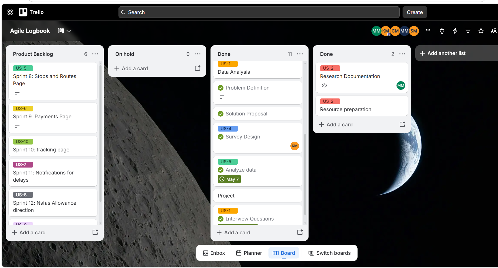
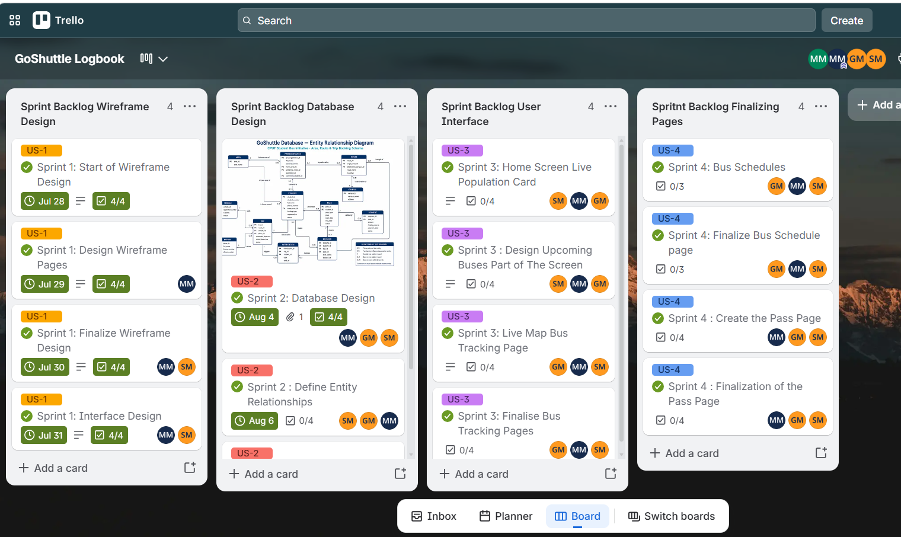
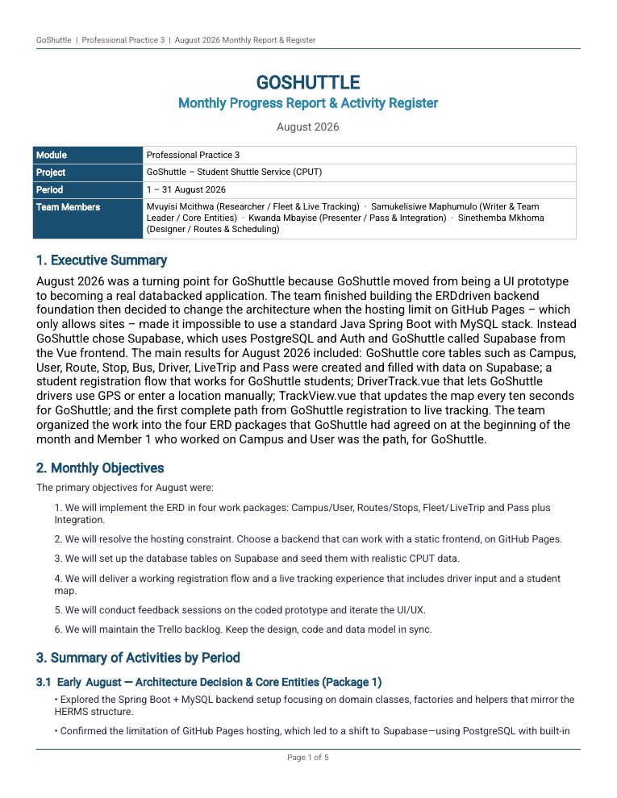
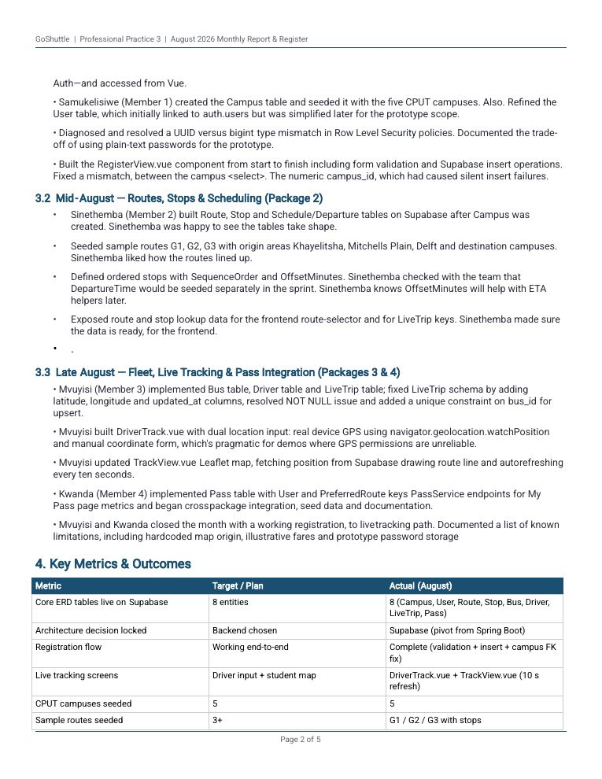
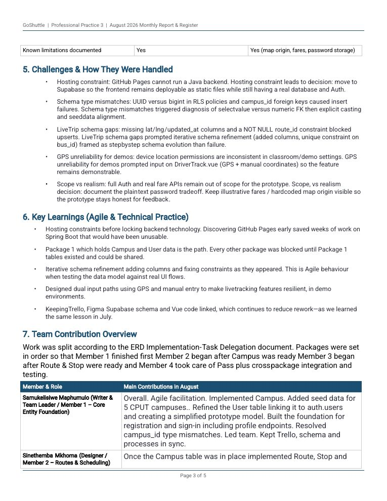
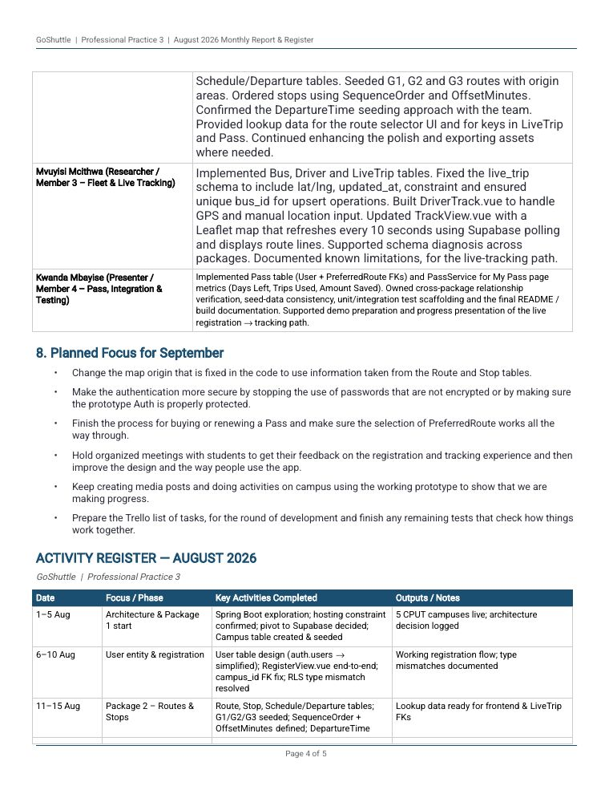
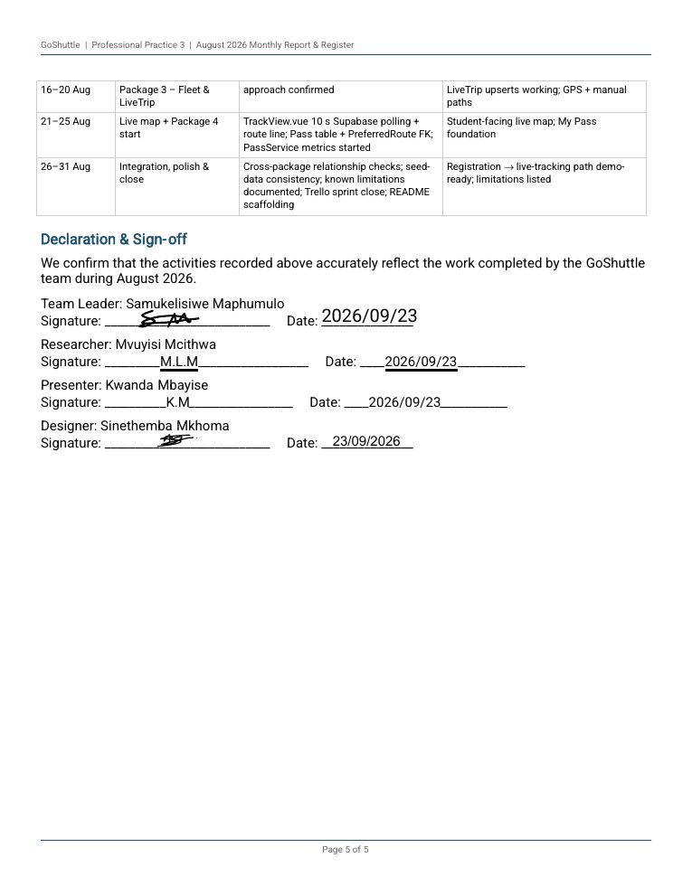

# I'm Mvuyisi Mcithwa

📞 060 679 5254  
📧 [mvuyisilindo@gmail.com](mailto:mvuyisilindo@gmail.com)  
🔗 [GitHub Profile](https://github.com/MvuyisiCPUT)

*I enjoy building practical software solutions for real-world problems. Generating ideas and turning them into working systems fuels my creativity and productivity.*

## 🧭 Contents

| | |
| --- | --- |
| [Education](#-education) | [Technical Skills](#-technical-skills) |
| [Projects](#-projects) | [Mock Interview and Reflection](#-mock-interview-and-reflection) |
| [References](#-references) | [Agile Project Portfolio](#-agile-project-portfolio) |
| [Agile Team Charter](#-agile-team-charter) | [User Stories and Tasks](#-user-stories-and-tasks) |
| [Product Backlog](#-product-backlog) | [Sprint Backlog](#-sprint-backlog) |
| [Agile Logbook](#-agile-logbook) | [Overall Reflection](#-overall-reflection) |

---

## 🎓 Education

**High School**
- Sir John Adamson High School

**University**
- Cape Peninsula University of Technology
- Higher Certificate in ICT
- Diploma in ICT Application Development *(Present)*

## 💻 Technical Skills

**Programming Languages**
- **Java** (OOP, Data Structures & Algorithms, Spring Boot)
- **SQL** (Queries, Joins, Normalization)
- Python
- JavaScript (Fetch API)
- HTML, CSS and JSON

**Tools & Platforms**
- NetBeans
- IntelliJ
- Figma

## 🚀 Projects

### 📚 My Learning (Personal Project)
- Built a full-stack web application
- Designed the UI using Figma
- Backend developed with Java (API & logic)
- Frontend built with HTML, CSS and JavaScript
- Implemented real-time form handling
- Integrated AI-driven search to generate personalised learning paths
- Fetches curated video courses via external APIs

### 💰 Expense Tracker (Group Project)
- Developed a personal finance tracking tool
- Java backend with an SQL database
- Simple web interface using HTML, CSS and JavaScript
- Tracks expenses and generates summaries

## 🎥 Mock Interview and Reflection

<video controls style="width: 100%; max-height: 420px;">
  <source src="/MvuyisiCPUT.github.io/mock-interview-video.mp4" type="video/mp4">
  Your browser does not support the video tag.
</video>

### My earlier reflection

#### GitHub Markdown

Coding in markdown for my profile has made it look alive, scannable, professional and would be beneficial for me when recruiters look in my profile and see an interactive resume. Writing in markdown has forced me to communicate clearly and be able to document my work properly.

I first learned about markdown by watching tutorials and through those tutorials I got ideas of which features of markdown I want to add on my resume. To code using markdown for the first time was like coding with any other language that I coded with for the first time as some code didn’t work or I was implementing it the wrong way, so I ended up changing some of the features that I intended to add but couldn’t.

Through YouTube tutorials and some other sources I slowly but surely was able to code using markdown and had fun whilst deciding which features to add such as logo or icons. At the end I had an eye-appealing resume because of markdown and it was very engaging.

#### Mock Interview

The mock interview was very interesting as I had to make sure that I looked professional and also the setting for the video was professional as well. There were a lot of retakes as I had to make sure that I sounded good and what I said was very clear. Through this cutting and retaking I got to listen to myself how I sound and how I speak and this gave me some self-awareness and this is important for myself when I’m being interviewed so that I don’t become too self aware during the interview which could make me shy and lose my points.

What I said in the video was like a practice of what I could say in the interview, so this was a time for me to see what to include and not to include when I’m being asked about myself, when I’m being asked about my future goals or if I’m being asked what I like about what I’m studying or job.

Overall the mock interview was like a mirror to see myself whilst I was preparing for what is to come, such as interviews, and to make adjustments where I feel I need to.

#### Deployment on GitHub Pages

Whilst building a portfolio I need a live website where recruiters can easily view my cv and my work. Using GitHub Pages is a free and integrated solution as traditional hosting options are either paid or overly complex so GitHub benefits me a lot.

My goal is to deploy a clean, professional site that has my resume and direct links to my repositories all hosted directly from my GitHub account. That site updates automatically whenever I’m going to add new content or improvements, without manual interventions.

I created a dedicated repository named MvuyisiCput.io. I added my Markdown file for the resume which at this point is the only file I have added. In the repository Settings at Pages, I configured the source to deploy from the main branch (root folder) and enabled HTTPS.

The portfolio went live on the web within minutes of the first deployment. Changes now reflect automatically after each commit, saving significant time. The site successfully showcases my technical work in a polished, accessible way.

Deploying GitHub Pages taught me the value of simple, automated pipelines even for simple static sites. It reinforced that professionalism and great documentation matter.

## 📌 References

**Mr. S.W Meyers**  
Principal, Sir John Adamson High School  
📞 011 680 2453

---

## 🧩 Agile Project Portfolio

*Project Presentation 3 (PRP370S, PRP371S, PRP372S)*

This part of my portfolio is my evidence of working in an Agile team on **GoShuttle**, a student transport initiative that partners CPUT with Golden Arrow Bus Service to run dedicated, subsidised bus routes for students who struggle with unreliable transport.

I was the team’s Researcher. I drafted our pre-registration Google Form, led the MoSCoW prioritisation of our backlog, and built the fleet and live-tracking tables and the driver and student tracking screens.

It follows four steps. I **collected** artefacts from the project, **selected** the ones that best show my learning, **reflected** on each, and **connected** them into one account of how our team planned and delivered its work. Each section below has the evidence first and my reflection after it.

---

## 📋 Agile Team Charter

Our team’s shared agreement on purpose, roles, ways of working and decision-making, written at the start of the project and reviewed at each retrospective.

### 🎯 Evidence

#### 1. Team Purpose & Vision

**Team mission:**  
To help CPUT students who struggle with unreliable transport by providing access to dedicated buses, mitigating the problem of arriving late or missing classes.

**Success definition:**  
A fully mapped pilot route covering at least two high-density pickup points with a proposed schedule, pricing model, and WhatsApp bot prototype ready for testing by the end of the year.

**Product / Service:**  
**GoShuttle** – A student transport initiative partnering CPUT with Golden Arrow Bus Service (GABS) to run dedicated, subsidised bus routes from high-density residential areas to CPUT's Bellville and Cape Town campuses.

#### 2. Team Members & Roles

| Name | Role | Responsibility |
|  |  |  |
| Sinethemba Gift Mkhoma | Designer | Create all visual elements: infographics, maps, charts, routes, diagrams, PowerPoint slides |
| Samukelisiwe Maphumulo | Writer | Lead drafting and compilation of all deliverables: main report, executive summary, supporting documents |
| Kwanda Mbayise | Presenter | Lead delivery of the final presentation |
| **Mvuyisi Mcithwa** | **Researcher** | Lead primary and secondary research: conduct interviews, surveys, validation |

#### 3. Ways of Working

**3.1 Agile Framework**
- **Kanban** – Trello (central task board, progress updated daily)

**3.2 Ceremonies**
- **15-minute stand-up:** every Monday & Wednesday
- **Weekly team meeting:** every Friday (review completed work, plan the next sprint)
- **Sprint goals:** every two weeks, ensuring the client sees consistent progress

#### 4. Working Agreements

- We show up prepared and on time
- We respect timeboxes
- We give constructive feedback
- We raise blockers early
- We commit to continuous improvement
- We embrace changing requirements: flexibility leads to a better product, even if it means revisiting earlier decisions

#### 5. Communication

**Primary channels**

| Channel | Used for |
|  |  |
| WhatsApp | Quick updates, urgent messages |
| Email | Formal communication with stakeholders, documentation sharing |
| Microsoft Teams | Scheduled meetings |
| Trello | Daily progress updates |

**Response-time expectations:** Urgent WhatsApp messages are answered within 2 hours during 8am–6pm; non-urgent within 24 hours.

**Remote / hybrid norms:** Camera on for Friday team meetings; available on Microsoft Teams during agreed core hours (10am–3pm).

#### 6. Decision-Making

- [x] Consensus
- [x] Product Owner final decision
- [x] Team vote

**Escalation path if we're stuck:**  
If the team vote is deadlocked, escalate to the weekly Friday meeting for a facilitated discussion. If still unresolved, the researcher gathers additional data within 48 hours and the team re-votes.

#### 7. Definition of Done (DoD)

- Code completed and reviewed by the team
- Research results recorded
- Documents updated
- Team agrees work is finished
- Shared with the group on Trello

#### 8. Core Values & Behaviours

Respect · Transparency · Accountability · Trust · Learning mindset

#### 9. Risks & Constraints

**Known risks**
- Golden Arrow may not commit without formal CPUT backing
- Student survey response rate below 200
- WhatsApp bot development requires technical skills beyond the current team

**Dependencies**
- CPUT Student Affairs department approval
- Golden Arrow Bus Service representative availability
- SRC support for survey distribution

**Constraints (time, budget, tools, skills)**
- No budget for incentives (surveys are voluntary)
- Timeline: Week 2 to Week 12 (term-based)
- Limited access to official CPUT student data

#### 10. Review & Improvement

**Charter reviewed every:**
- [ ] Quarter
- [x] Release
- [x] Retrospective

**Last updated:** 04/05/26

#### 11. Team Commitment

*By working on this team, we commit to the principles and agreements outlined above.*

| Name | Signature / Agreement |
|  |  |
| Sinethemba Gift Mkhoma | S.Mkhoma |
| Samukelisiwe Maphumulo | S.Maphumulo |
| Kwanda Mbayise | K.Mbayise |
| Mvuyisi Mcithwa | M.Mcithwa |

### 💭 Reflection

As a researcher on the on the GoShuttle team, I conducted research of what an Agile team charter is and what is the importance of it at the start project. An Agile team charter is a contract between team members and stakeholders(the people who will benefit in the success of the project), it is created at the start of the project to define the teams shared purpose, goals, values, roles, working agreements and operating norms. I then presented this research to the team in order to formulate our own. My role also appears in the charter itself: if a vote is deadlocked, the researcher gathers extra data within 48 hours so the team can re-vote, which made my research feed directly into how we make decisions *

Before this, I thought a charter was just a document that gives direction of how the project will be completed. I now understand it is a living agreement that sets expectations before problems appear. The section that taught me the most was Definition of done, when we were defining that section we knew that some parts of the project might change due to unforeseen circumstances and so in the definition of done we only staterd we knew will be deffinately done and yes parts of the project we planed did change. Our Kanban board on Trello, the Monday and Wednesday stand-ups and the Friday review meeting showed me that planning as a team is important than planning alone on what you will do in the project. It gets you to discuss with on what you will do for the week in the project and get to know what everyone else will be busy with so that your tasks do not clash. The meetings personally made me productive and they help us to keep everyone accountable.*

What worked well is that group members were able to deliver their work when its due even though we faced challenges with assigning work to people because group members were not available in some days due to their commitments and that created uncertainty when assigning work because we couldn't know whether that group member will be able to complete that work. This resulted in some members to take on more work.

The charter gave us something to return to when when we have challenges or conflicts. For example, our agreement to "raise blockers early" helped us when team members couldn't be able to complete their work or were struggling with something and could raise these blockers to prevent work from not being deliverd. Our risk section also predicted we might get responses that are below 200 and that happened, which showed me that having expectations can help coming up with a plan to solve that problem in time to reduce the demage of that problem .

Next time I would review the charter every week before meetings instead of reviewing it at the start only because it will sever as a reminder to our commitments to prevent conflicts. I would also remind everyone to review the chatter every week because group members to forget their responsibilities in the project. The other one is to not take other people's responsibilities because this can course group members to leave responsivity to one person.

The charter links to my logbook because the logbook breaks down what the chatter mentions of what should be done in the project into detail and the sprint backlog breaks it down further of what should be done every week.

---

## 📝 User Stories and Tasks

User stories describe what a feature must do from the end user’s point of view. Ours cover two users, the student and the bus driver, and became the work we planned in each sprint.

### 🎯 Evidence

| ID | As a... | I want... | So that... |
| --- | --- | --- | --- |
| US1 | Student | An app | I can know bus schedules, track the bus and make payments |
| US2 | Student | To view the bus routes | I can see which route is best for me to travel on |
| US3 | Student | To make payments on the app | I can renew my pass |
| US4 | Driver | An app | I can connect my phone to the GPS so that a student can track the bus I am driving |
| US5 | Student | An app | I can see the bus stops in each area |

**Tasks:** Each story was broken into tasks on our Trello board (see the [sprint backlog](#-sprint-backlog)). Examples: Home Screen Live Population Card, Live Map Bus Tracking Page, Create the Pass Page.

### 💭 Reflection

Writing the GoShuttle stories taught me that a user story describes what a person needs and why, from their point of view, and not how the feature will be built. As a student I want an app so that I can know bus schedules and track the bus

Our stories covered two users, the student and the driver. The driver’s story (US4) mattered because students could only track the bus if the driver’s phone was connected to the GPS, so the students’ story depended on the driver’s. This showed me that when developing a sysytem to solve one users problem can bring other user

On 21 July the team turned the features from our MVP week into 14 user stories. Some were still too broad, so we split the “Book a trip” story into three smaller cards, which made progress easier to see on Trello. What I learnt from this is that user stories should be short and specific.

I led the MoSCoW prioritisation of the stories. The feedback we collected from students , about pricing and trust, decided which stories became Must Have, and the six highest-value stories made up the first design sprint. Leading these discussions gave me valuable experience in gathering and prioritising user needs for the system.

What worked well for us is that we were able to brainstorm the right questions to ask our users what they needed from the system in odder to formulate these user stories. What was challenging was to get the users to ask these questions

Next time for better understanding I would change the formula of writing this user stories for example I would write “I want to track the bus” instead of “I want an app”, split US1 into smaller stories, or add tasks to each story because the more the user story is understable the better the changes of producing a system with bettter functionality that satisfiers the users.

The stories link to the rest of my portfolio because they became the cards in our product backlog and sprint backlog, for example As a: Student,I want : An app,So that: I can track the bus.The card must display where the bus is coming from and where its going.

---

## 📦 Product Backlog

The ordered list of everything the product might need. We prioritised it with MoSCoW, and real student feedback from the pre-registration week decided which stories became Must Have.

### 🎯 Evidence

*Our Trello product backlog and completed research cards.*

| Story | Backlog item | Planned for |
| --- | --- | --- |
| US-5 | Stops and Routes Page | Sprint 8 |
| US-6 | Payments Page | Sprint 9 |
| US-10 | Tracking page | Sprint 10 |
| US-7 | Notifications for delays | Sprint 11 |
| US-8 | NSFAS Allowance direction | Sprint 12 |

### 💭 Reflection

> ✏️ *Replace this with your own reflection. Prompts to answer:* How did we decide what went at the top of the backlog? Which item moved because of student feedback (pricing, trust, NSFAS)? What did I learn from leading the MoSCoW discussion? What would I prioritise differently?

---

## 🏃 Sprint Backlog

The work the team committed to in each sprint, tracked card by card on Trello.

### 🎯 Evidence

*Our sprint backlog lists on Trello, with dates, checklists and assigned members.*

| Sprint backlog | Story | Main cards |
| --- | --- | --- |
| Wireframe Design | US-1 | Start of wireframe design, design wireframe pages, finalize wireframe design, interface design (cards dated 28 to 31 Jul) |
| Database Design | US-2 | Database design (entity relationship diagram), define entity relationships (cards dated from 4 Aug) |
| User Interface | US-3 | Home screen live population card, upcoming buses section, live map bus tracking page, finalise bus tracking pages |
| Finalizing Pages | US-4 | Bus schedules, finalize bus schedule page, create the pass page, finalization of the pass page |

### 💭 Reflection

> ✏️ *Replace this with your own reflection. Prompts to answer:* How did the sprint backlog help us see progress? Which card or sprint taught me the most (for example the database design sprint)? Where did we fall behind and how did we respond? What would I do differently when planning a sprint?

---

## 📖 Agile Logbook

A running record of daily plans, what actually happened, blockers and decisions, and reflections. Each period opens in full below.

### 🎯 Evidence

### 4 to 7 July: business model and architecture

Business Model Canvas, logo direction, solution architecture and the HTML redesign conversion.

Read the full logbook

#### Day 1 — Saturday, 04 July

**Focus:** Business Model foundation + Logo exploration (Part 1)

**Planned:** Samukelisiwe and Mvuyisi to draft the initial Business Model Canvas (customer segments, value proposition, channels and revenue ideas). Sinethemba and Kwanda to begin reviewing the existing HTML redesign and outline the solution architecture.

**Actual:** Samukelisiwe and Mvuyisi completed a first-pass Business Model Canvas, focusing on CPUT students in Khayelitsha, Mitchells Plain, Delft and Kraaifontein as the primary segment. They also sketched three logo direction concepts (wordmark + simple shuttle icon). Kwanda and Sinethemba mapped the high-level solution architecture (frontend pages, booking flow, future tracking) and started converting the redesign HTML into cleaner, semantic web structure.

**Blockers / decisions:** Logo concepts were still too generic. Decision: keep exploring options that signal trust and student-friendliness rather than forcing a final choice on day one.

**Reflection:** Starting the business model early forced us to be explicit about who we are serving and how we create value — this clarity later helped when we designed the MVP messaging.

#### Day 2 — Sunday, 05 July

**Focus:** Business Model refinement + Logo shortlist + Architecture continuation

**Planned:** Refine the Business Model Canvas (especially value proposition, key partnerships and cost structure). Narrow logo options. Continue HTML-to-web conversion and architecture documentation.

**Actual:** Samukelisiwe and Mvuyisi tightened the value proposition around affordability, reliability and trust (Golden Arrow partnership angle already emerging). Two stronger logo directions were selected for further work. Kwanda and Sinethemba progressed the solution architecture document and converted key pages (Home and Booking structure) from the redesign into more maintainable HTML/CSS.

**Blockers / decisions:** Some architecture decisions (how much to hard-code vs prepare for future backend) were unclear. Decision: keep the current build frontend-focused and document future integration points clearly.

**Reflection:** Working in two parallel streams (business + design/architecture) felt productive, but we needed better end-of-day sync so both pairs stayed aligned on the overall vision.

#### Day 3 — Monday, 06 July

**Focus:** Logo finalisation direction + Solution architecture detail + Web conversion progress

**Planned:** Move toward a preferred logo direction. Detail the solution architecture (user flows, page structure, tech choices). Continue converting remaining redesign screens into proper web pages.

**Actual:** Samukelisiwe and Mvuyisi finalised a preferred logo direction (clean wordmark with subtle mobility icon) and linked it back to the business model’s trust and student- centric positioning. Kwanda and Sinethemba completed a clearer solution architecture outline and advanced the HTML conversion for the Confirmation and basic Tracking placeholder pages.

**Blockers / decisions:** Converting the redesign revealed some inconsistent spacing and mobile issues. Decision: prioritise mobile-first adjustments while converting, rather than leaving them for later.

**Reflection:** Seeing the business model, logo and technical structure develop side-by- side made the project feel more coherent. The logo work benefited directly from the clearer value proposition.

#### Day 4 — Tuesday, 07 July

**Focus:** Integration review + Documentation close-out

**Planned:** Cross-review the Business Model Canvas, preferred logo direction, solution architecture and converted web pages. Capture decisions and prepare for the next phase (MVP design & launch).

**Actual:** The full team reviewed the outputs together. Minor adjustments were made to the Business Model (channels and early revenue assumptions). The preferred logo direction was agreed as the working version. Solution architecture and the converted HTML pages were documented and stored. Trello / task tracking was updated with completed items.

**Blockers / decisions:** We still lacked real user validation for parts of the business model. Decision: treat the current canvas as a living draft and test key assumptions (pricing, trust, channels) during the upcoming MVP week.

**Reflection:** Closing the week with a joint review helped the two pairs understand each other’s work. Moving from pure design/architecture into validated learning next week feels like the natural Agile next step.

### 14 to 17 July: MVP launch and campus activation

WhatsApp flyer, Google Form and an info table at the Bellville campus.

Read the full logbook

#### Day 1 — Monday, 14 July

**Focus:** MVP Day 1 — Design & launch (part 1)

**Planned:** Design the WhatsApp flyer, draft the four-question Google Form, review copy against our 5W messaging, and list the ten target CPUT WhatsApp groups.

**Actual:** Sinethemba completed the flyer design by midday. Mvuyisi drafted the Google Form but paused halfway through when we realized we hadn't confirmed the final order of home-area options. We agreed to use Khayelitsha, Mitchells Plain, Delft, and Kraaifontein, matching the refined target market from Improvement 1. Kwanda managed to confirm access to eight of the ten target WhatsApp groups; two group admins had not yet approved our join requests by end of day.

**Blockers / decisions:** Two WhatsApp groups were still pending admin approval. We decided to proceed with the eight confirmed groups on 15 July and add the remaining two once access was granted, rather than delay the whole launch.

**Reflection:** We should have requested access to the WhatsApp groups earlier in the week rather than on the same day we needed them — gatekeeper approvals take time we didn't account for in our planning.

#### Day 2 — Tuesday, 15 July

**Focus:** MVP Day 1–2 — Design & launch (part 2)

**Planned:** Finalize and post the flyer and Google Form link to the ten WhatsApp groups, track posting progress, and begin logging pre-registrations.

**Actual:** We posted to all eight confirmed groups by 10am. By early afternoon the form had only around six responses, which was slower than we expected. Samukelisiwe reached out to other WhatsApp groups . Responses picked up noticeably afterward, ending the day at 14 pre-registrations, mostly from Khayelitsha.

**Blockers / decisions:** Organic WhatsApp sharing alone was not generating responses fast enough. We decided to reach out to other WhatsApp groups that had number.

**Reflection:** Posting on student WhatsApp groups made a real, measurable difference to response rate. In future phases we should involve the SRC from day one rather than treating it as a backup channel.

#### Day 3 — Wednesday, 16 July

**Focus:** MVP Day 3 — Campus activation (part 1)

**Planned:** Print flyers with the Google Form QR code, set up an info table at the CPUT Bellville campus entrance, hand out flyers, and record student feedback.

**Actual:** The table ran from 8am to 12pm at the Bellville entrance. We distributed roughly 120 printed flyers. Several students stopped to ask questions, most commonly about pricing compared to taxis and whether the pass could be paid using NSFAS funds. A few students were visibly skeptical of a new, unbranded transport service.

**Blockers / decisions:** Trust was a recurring concern among students we spoke to..

**Reflection:** Naming the golden arrow backing upfront visibly changed how open students were to signing up. This is a messaging lesson we will carry into all future outreach, not just campus activation.

#### Day 4 — Thursday, 17 July

**Focus:** MVP Day 4 — Campus activation (part 2) + interim check-in

**Planned:** Continue campus activation, compile the interim pre-registration count and home-area spread, cross-check against our MVP success targets, and decide whether to bring forward the social media push.

**Actual:** We ran the table again from 8am to 11am. By the end of the day total pre-registrations reached 41, spread across three confirmed home areas (Khayelitsha, Mitchells Plain, Delft). About 35% of respondents indicated willingness to pay R20 or more per trip.

**Blockers / decisions:** We were behind two of our five success metrics — total sign-ups (41 vs. a target of 50) and willingness to pay (35% vs. a target of 40%). As a team we decided to bring forward the TikTok/Instagram comparison video originally scheduled for Days 5–6, to try to close the gap before the seven-day test window closes.

**Reflection:** Falling slightly short of two targets midway through the test wasn't a failure — it was useful information. Adjusting our schedule in response, rather than waiting passively for the original plan to play out, felt like the clearest example this week of actually working in an Agile way rather than just calling our process Agile.

#### Summary of learning

Across this stretch, the biggest lessons were about timing and trust rather than the product itself. Gatekeeper-dependent tasks (WhatsApp group access) needed longer lead times than we planned for, and leading with our golden arrow partnership consistently outperformed leading with the product features when talking to students. Both insights fed directly into our decision to bring the social media phase forward rather than sticking rigidly to the original seven-day sequence — the kind of responsive adjustment the Agile approach is meant to support.

### 21 to 24 July: Trello board, user stories and wireframes

Trello setup, 14 user stories prioritised with MoSCoW, and Figma wireframes.

Read the full logbook

#### Day 1 — Tuesday, 21 July

**Focus:** Digital product foundation — Trello board setup & backlog definition

**Planned:** Create the Trello board structure (Backlog, To Do, In Progress, Review, Done), write the initial user stories for the core booking and tracking flows, and prioritise the first sprint backlog based on the pre-registration insights from the previous week.

**Actual:** The board was fully set up by mid-morning. We translated the key features identified during the MVP (home-area selection, trip booking, fare estimate, real-time tracking, and Golden Arrow partnership messaging) into 14 user stories. Mvuyisi led the prioritisation discussion using MoSCoW. By end of day the “Must Have” column contained the six highest-value stories for the first design sprint.

**Blockers / decisions:** Some stories were still too broad. We decided to split the “Book a trip” story into three smaller cards (select route & time, confirm fare, receive confirmation) so that progress would be more visible on the board.

**Reflection:** Spending a full morning on board structure and story granularity felt slow at first, but it immediately made the rest of the week clearer. The previous week’s real user feedback (pricing concerns and trust) directly shaped which stories we marked Must Have — a clear example of feedback feeding the backlog.

#### Day 2 — Wednesday, 22 July

**Focus:** Figma wireframes — core screens (part 1)

**Planned:** Produce low-fidelity wireframes for the four primary screens: Home / Route selector, Booking form, Confirmation, and Live tracking.

**Actual:** Sinethemba led the Figma session while the rest of the team contributed content and logic. By late afternoon we had solid low-fi versions of the Home screen, Route & time selector, and Booking form. We deliberately kept the Golden Arrow partnership visible on the home screen after the trust lessons from campus activation.

**Blockers / decisions:** We debated whether to show exact fares or a range. Decision: show a clear “from R60 000” estimate plus the note that final fare is confirmed at booking, to avoid the scepticism we heard on campus.

**Reflection:** Designing the screens while constantly referring back to the real student questions from the previous week kept the wireframes grounded. It was easier to stay user-focused when we could point to actual comments rather than hypothetical personas.

#### Day 3 — Thursday, 23 July

**Focus:** Figma wireframes — remaining screens + internal review

**Planned:** Complete the Confirmation and Live tracking screens, then run an internal walkthrough of the full flow.

**Actual:** The remaining two screens were finished by midday. In the afternoon the whole team walked through the end-to-end flow on Figma. Several small usability issues were spotted (unclear back navigation and missing “contact driver” affordance on the tracking screen). These were fixed on the spot.

**Blockers / decisions:** Tracking screen initially felt too sparse. We decided to add a simple status timeline (Booked → Driver assigned → En route → Arrived) so students would feel more informed — addressing the trust gap identified earlier.

**Reflection:** Doing the walkthrough the same day the screens were finished caught problems while they were still cheap to fix. Waiting until a formal “review day” would have slowed us down.

#### Day 4 — Friday, 24 July

**Focus:** Wireframe refinement + Trello sync + next-sprint planning

**Planned:** Polish the wireframes, move completed design cards to Done on Trello, and plan the next steps (high-fidelity designs and possible student feedback session).

**Actual:** Minor visual and copy refinements were completed. All core wireframe cards were moved to Done. We added five new cards for the next phase (high-fi visual design, micro-interactions, and a short student feedback round). The board now clearly shows the first design sprint is closed.

**Blockers / decisions:** We were slightly behind on documenting the design decisions. Samukelisiwe created a short “Design Decisions” card on the board so future team members (or markers) can see why certain choices were made.

**Reflection:** Closing the sprint properly on Trello — rather than just finishing the Figma file — gave a satisfying sense of completion and made the hand-off to the next phase cleaner. The combination of a living board and living wireframes felt more Agile than producing a static set of screens.

### 28 to 31 July: coded interface

A clickable, mobile-first prototype of the home, booking and tracking screens.

Read the full logbook

#### Day 1 — Tuesday, 28 July

**Focus:** Finish wireframes + begin coded interface

**Planned:** Finalise any outstanding high-fidelity refinements in Figma, export assets, and start translating the core screens (Home / Route selector and Booking form) into code.

**Actual:** Sinethemba completed the last visual polish on the Confirmation and Live Tracking screens by mid-morning. The team then began coding the interface. We set up the basic project structure and successfully implemented the Home screen layout and navigation shell. By end of day the Route selector skeleton was also in place.

**Blockers / decisions:** Slight mismatch between Figma spacing and the coded version on smaller screens. We decided to prioritise mobile-first (student phone usage) and adjust the code rather than go back to redesign the wireframes.

**Reflection:** Moving from static wireframes into real code immediately exposed practical constraints (screen real estate, touch targets). This reinforced why we kept the earlier designs relatively simple.

#### Day 2 — Wednesday, 29 July

**Focus:** Code the Booking flow

**Planned:** Build the interactive Booking form (route, time, fare estimate, confirmation button) and link it to the Home screen.

**Actual:** The Booking form was coded and connected. Basic form validation and a temporary “from Rxx” fare display were added. We also began wiring the Confirmation screen so the full happy-path flow could be clicked through. Progress was tracked on the Trello board by moving the corresponding cards into In Progress and then Review.

**Blockers / decisions:** Fare calculation logic was still unclear (we only have survey data, not live pricing). Decision: hard-code a realistic estimate range for the prototype and clearly label it “illustrative” so testers understand it is not final.

**Reflection:** Having the Trello board open while coding made it easy to see which pieces of the flow were still missing. It prevented us from over-polishing one screen while others lagged behind.

#### Day 3 — Thursday, 30 July

**Focus:** Live Tracking screen + end-to-end flow

**Planned:** Code the Live Tracking screen (status timeline + map placeholder) and ensure the full user journey works without broken links.

**Actual:** Tracking screen implemented with the status timeline (Booked → Driver assigned → En route → Arrived) that we had decided on during the wireframe phase. A simple map placeholder and “contact support” button were added. The team tested the complete flow several times and fixed navigation bugs.

**Blockers / decisions:** Real-time map integration is out of scope for this prototype. We decided to keep a static map image with a clear “live tracking coming soon” note rather than spend time on a complex integration that would delay the rest of the interface.

**Reflection:** Reusing the exact status language from the wireframes into the coded version kept the experience consistent and saved time. Small design decisions made earlier paid off once we started building.

#### Day 4 — Friday, 31 July

**Focus:** Polish, bug fixes & sprint close

**Planned:** Fix remaining visual and interaction issues, update the Trello board, and prepare the coded prototype for internal review / next-week testing.

**Actual:** Final spacing, button states, and mobile responsiveness adjustments were completed. All core interface cards were moved to Done on Trello. We recorded a short walkthrough video of the coded flow and noted open items (real fare API, authentication, actual map) as candidates for the next backlog.

**Blockers / decisions:** A few residual layout shifts on older Android browsers. Decision: document them as known issues rather than chase perfect cross-browser support at this stage; the priority is a clean, usable prototype for student feedback.

**Reflection:** Closing the coding sprint properly on Trello (instead of just having “working files”) gave a clear sense of progress and made the hand-off to testing next week straightforward. The combination of finished wireframes and a clickable coded interface feels like a solid foundation.

### August: backend and live tracking

Monthly progress report and activity register: the move from Spring Boot to Supabase, the core tables, student registration and live tracking.

Read the full monthly report and register

### 💭 Reflection

> ✏️ *Replace this with your own reflection. Prompts to answer:* What did keeping a logbook change about how I worked? Which entry shows us adapting the plan (the 17 July decision, the move to Supabase)? What was my own part in these weeks? How did the logbook link to Trello and to the retrospectives in the charter?

---

## 🏁 Overall Reflection

This section connects the five artefacts into one story of how our team worked.

### 💭 Reflection

> ✏️ *Replace this with your own reflection. Prompts to answer:* How do the charter, user stories, backlogs and logbook link together? What did I learn about Agile teamwork overall, and what will I carry into my next project? Where did we work in an Agile way, rather than only saying we did?
